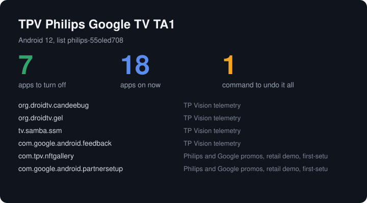

<div align="center">

# sofapilot

**Let Claude or Codex clean up any Android TV over Wi-Fi, with undo for every change.**

Debloating TVs is having a moment, led by [cleanyourtv](https://github.com/Gathin23/cleanyourtv) and [Tellyscope](https://github.com/man15h/tellyscope). This puts that job in your coding agent, with the see-and-tap tools of [Phone Harness](https://github.com/phone-harness/mcp), and it needs no cloud account.

Works with **Claude Code** and **Codex**.

  



<sub>Real output from <code>plan --card</code>, run against the pretend TV in <a href="examples/fake_adb.py">examples/fake_adb.py</a>.</sub>

</div>

> **Read this first.** No real TV has been used with this yet. Every test runs against a simulator that answers the way the `adb` documentation says a TV does. The debloat lists are real and come from people's own TVs, but a real TV may still surprise this tool. Start with `plan`, change one app, and try `undo`. If you try it, a report would help a lot.

## Quick start

See the whole job on a pretend TV, with no hardware:

```bash
git clone https://github.com/Dodai0419/sofapilot && cd sofapilot
python sofapilot.py --demo
```

```text
This is a pretend TV, not real hardware.

TP Vision telemetry
  [x] org.droidtv.candeebug  ("DAC" analytics uploader)
  [x] tv.samba.ssm  ("Samba Services Manager": Samba TV ACR (identifies what is on screen) ...)

7 of 8 apps ticked. 18 apps are on now. Nothing has changed.

Turned off 7 apps. Apps on: 18 -> 11
After undo --all, apps on: 18. The TV is restored.
```

Then, on a real TV, with [Android platform-tools](https://developer.android.com/tools/releases/platform-tools) installed:

```bash
python sofapilot.py connect 192.168.1.50
python sofapilot.py plan
```

You need Python 3.9 or newer and `adb`. There is nothing else to install.

### Install in Claude Code

```bash
/plugin marketplace add Dodai0419/sofapilot
/plugin install sofapilot@sofapilot
```

The plugin adds the skill and the MCP server. Then say: *"My TV is at 192.168.1.50. Make it faster and get rid of the ads, and show me what you'll change first."*

### Install in Codex

```bash
git clone https://github.com/Dodai0419/sofapilot && cp -r sofapilot/skills/* ~/.codex/skills/
codex mcp add sofapilot -- python /full/path/to/sofapilot/sofapilot.py mcp
```

Or copy `AGENTS.md` to your project root.

## The problem

- TVs ship with apps that report what you watch, show ads on the home screen and slow everything down.
- Copying `adb` commands from a forum is risky. Disable the wrong package and the TV can stop booting, and nothing records what you changed.
- An agent with raw shell access to your TV could do real damage. It should get a safe, narrow set of tools.

## The solution

| Idea | Fixes |
|------|-------|
| **427 model lists, bundled** | Hand-checked lists from cleanyourtv, kept by tellyscope-devices, in a 165 KB file with no download |
| **Off, never uninstalled** | Everything uses `pm disable-user`, which one command reverses. There is no uninstall code at all |
| **A journal for every change** | It records what was already off before the first change, and each change, so undo puts back only what it changed |
| **A protected list that always wins** | Apps needed to boot, update, stay online, show web pages or take input are refused, with no override |
| **No shell tool** | The agent gets 16 narrow tools. Names, numbers and text are checked, so nothing can smuggle in a command |

## How it stays safe

| Rule | How |
|---|---|
| You see it first | `plan` changes nothing. `apply` without `--yes` only prints what it would do |
| One bad name changes nothing | Every name is checked before the first app is touched |
| Protected apps stay on | System UI, settings, Play services, the store, WebView, keyboards, network, the current home screen and the list's "keep" apps |
| Only sure matches are ticked | A list is ticked only when it matches your model and Android version. Optional apps are never ticked. Any other list shows up unticked |
| Undo is exact | Apps that were off before you arrived stay off. Settings go back to the value they had |
| Each TV has its own journal | Stored in `~/.sofapilot/`, one file per TV, saved after every app |
| Nothing leaves your network | It talks only to your TV. The only exception is the ad-blocking DNS host, which the TV itself will use if you turn it on |

## Commands

**See**

| Command | What it does |
|---|---|
| `connect IP` | Connects to a TV on your Wi-Fi |
| `status` | Model, Android version, free storage and memory, app counts, matching list |
| `apps` | Every app, on or off, and which ones you installed |
| `lists WORDS` | Searches the 427 lists by brand or model |
| `plan` | What would be turned off. Add `--list ID`, `--json` or `--card FILE.svg` |
| `history` | Every recorded change |

**Change** (each can be undone)

| Command | What it does |
|---|---|
| `apply --yes` | Turns off the ticked apps |
| `apply --only a.b,c.d --yes` | Turns off exactly these apps |
| `dns on --yes` | Ad-blocking Private DNS. Uses AdGuard DNS unless you pass `--host` |
| `animations 0.5 --yes` | Faster animations |
| `undo` | Reverts the last change. Add `--all` for everything |

**Drive**

| Command | What it does |
|---|---|
| `screenshot -o tv.png` | Saves the screen |
| `elements` | Lists text and buttons with their coordinates |
| `key home` | Presses a button: home, back, menu, up, down, left, right, ok, play, mute, volume-up, volume-down, power |
| `type "text"` | Types into the focused field |
| `tap X Y`, `swipe X1 Y1 X2 Y2` | Touches the screen |
| `open PACKAGE` | Opens an app |

Add `--serial` before the command when several TVs are connected.

Exit codes: `0` success, `1` some apps could not be turned off, `2` refused or bad input.

## Tools your agent gets

Run it as an MCP server with `python sofapilot.py mcp`. The Claude Code plugin does this for you.

| Tool | What it does |
|---|---|
| `tv_status`, `tv_apps`, `tv_history` | Read the TV |
| `tv_lists`, `tv_plan` | Find a list and see what it would do |
| `tv_disable`, `tv_undo` | Turn apps off, and bring them back |
| `tv_private_dns`, `tv_animations` | Tweaks that can be undone |
| `tv_screenshot`, `tv_elements` | See the screen |
| `tv_key`, `tv_type`, `tv_tap`, `tv_swipe`, `tv_open` | Drive it |

An agent can check its own work: disable an app, take a screenshot, open a streaming app, and undo if something broke. The skill tells it to show you the plan and wait for your yes.

## Set up your TV

1. On the TV, open **Settings**, then **About**, and press OK on **Build** seven times.
2. Open **Developer options**. Turn on **USB debugging**, and **Network debugging** if your TV lists it.
3. Find the TV's IP address under **Network**.
4. Run `python sofapilot.py connect <IP>`.
5. On the TV, tick **Always allow from this computer** and press **Allow**.

Menu names differ by brand. Android 11 and newer may ask for wireless debugging and a pairing code, which you do with `adb pair`.

## Which TVs

There are 427 lists from these sources, and the match rules are simple:

| How your TV is matched | What happens |
|---|---|
| A list's exact match rule fits | Ticked if the Android version also matches |
| Your model name appears in a list's name | Ticked if the Android version also matches |
| No match | Nothing is ticked. Use `lists` to find a close one, then `plan --list ID` and choose apps yourself |

Only one list in the data has an exact rule today, so most TVs will rely on the model name or your own choice. Fire TV lists exist in the source data under their model names, but a pretend Fire TV has not been tested.

## Why this instead of Tellyscope

| | Tellyscope | sofapilot |
|---|---|---|
| Runs on | Your Android phone | Your computer |
| Who drives | You, by tapping | You or your agent |
| Debloat lists | 330+ models, kept fresh | The same source, a snapshot of 427 entries. `git pull` to update |
| Off, never uninstalled | Yes | Yes |
| Journal and undo | Yes | Yes |
| Protected list | Yes | Yes, written separately, and it may differ |
| Install APKs and launchers | Yes | No |
| Send files | Yes | No |
| CPU, RAM and network monitor | Yes | Basic status only |
| Tested on real TVs | Yes | **No** |
| License | GPL-3.0 | MIT, with no code from Tellyscope |

**Use Tellyscope** if you want a finished, tested app. It does much more. **Use this** if you want your agent to do the job, or you are at a computer with no Android phone.

And compared with Phone Harness: that gives agents cloud iPhones and Android emulators through an account. This gives them your own TV, on your own Wi-Fi, with no account.

## Benchmarks

Windows 11, Python 3.11, laptop, best of 5; the low end is a quiet machine, the high end a busy one. Run it yourself with `python bench/bench.py`.

| | Upstream | sofapilot |
|---|---|---|
| Debloat lists on disk | 1,618 KB across 427 files (`devices/`) | 165 KB, one file |
| Load all lists | not measured | 15 to 35 ms |
| Match a TV to a list | not measured | under 5 ms |
| Code | 277 files in Tellyscope (Kotlin, Android app) | 1 Python file |
| Dependencies | Android SDK and JDK 25 to build | Python standard library, `adb` |

The effect on a real TV's speed or free memory is **not measured**, because no real TV was available. No claim is made that your TV will get faster.

## Known limits

- **Not tested on real hardware.** See the top of this page.
- A disabled app can still return after a system update. Run `plan` again after an update.
- Screenshots and `elements` can come back empty in video apps that block capture.
- `input text` cannot type every character on every TV. Most non-English text will not arrive correctly.
- Fire OS may refuse some `pm` commands. Failures are reported per app.
- The protected list was written for this tool. It is a safety net, not a guarantee.

## Run the tests

```bash
python -m unittest -q
```

The suite takes a few minutes, because each pretend `adb` call starts a new process.

## Inspired by

- [man15h/tellyscope](https://github.com/man15h/tellyscope): the safety rules, read from its README. No code was used, since it is GPL-3.0.
- [phone-harness/mcp](https://github.com/phone-harness/mcp): the agent tools for seeing the screen, tapping, typing, swiping and opening apps.
- [man15h/tellyscope-devices](https://github.com/man15h/tellyscope-devices) and [Gathin23/cleanyourtv](https://github.com/Gathin23/cleanyourtv): the debloat lists, under MIT.

## Roadmap

- [ ] Run it on real TVs, and record which ones work.
- [ ] Check the list data for updates with one command.
- [ ] Switch the home screen to another launcher, with undo.

## License

MIT. See [NOTICE](NOTICE) for the data and projects this builds on.
